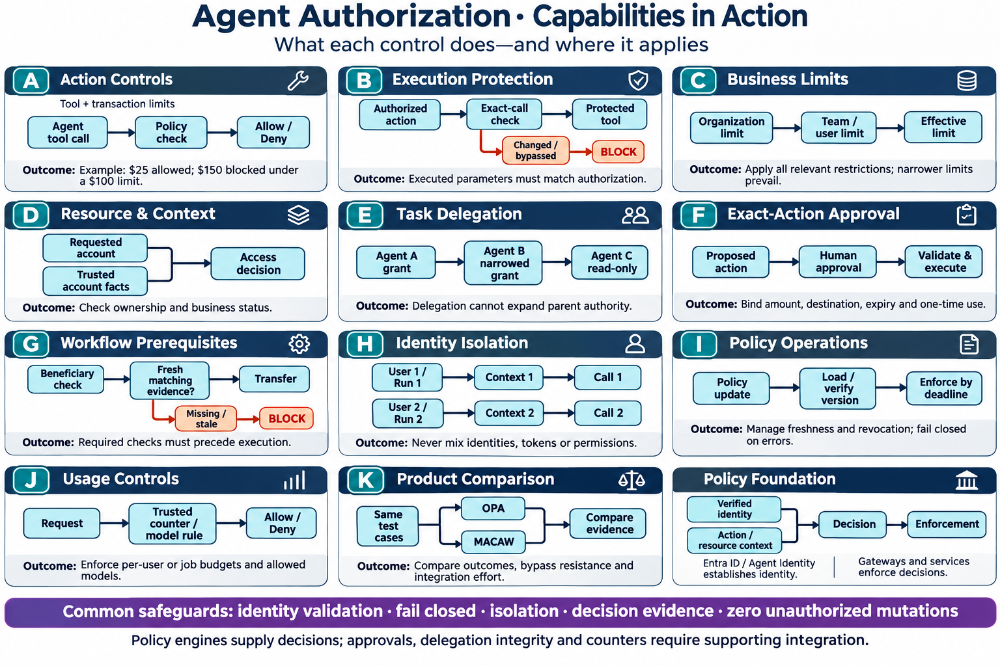

# Agent authorization capability flows — leadership

Created 2026-11-03 using built-in image generation. Conceptual capability flows, not deployment evidence or claims of native product parity. Letter labels A–K correspond to the POC capability catalog without phase numbers or prioritization. Gateways/services must enforce decisions using trusted identity, context and supporting state. The $100 threshold is an illustrative policy, not an enterprise requirement. Comparison branches represent independent product evaluations.

## Generation prompt

Use case: infographic-diagram. Create a polished leadership technical infographic in wide landscape format with a WHITE background, navy headings, readable large text, teal/blue flow boxes, sparse professional icons. Title “Agent Authorization · Capabilities in Action”. Subtitle “What each control does—and where it applies”.
PRIMARY REQUIREMENT: EXACTLY THREE EQUAL COLUMNS, four rows of cards. Reading order A B C, D E F, G H I, J K neutral foundation card. Each letter A–K appears ONCE as large card badge. EVERY lettered card has a title, a SHORT FLOW DIAGRAM with actual connected boxes and visible arrows, and one concise outcome statement. These must be real mini-flow diagrams not prose substitutes. No single shared top runtime chain necessary; maximize space for eleven card flows. Every card SAME visual weight; no priority highlight. No phase numbers, slice codes, “initial”, “future”, “later”, “start with”, project status or completion claims. Describe capabilities neutrally.

Exact 11 card specs (use compact line breaks and clean arrows):
A “Action Controls”
Flow: “Agent tool call” → “Policy check” → “Allow / Deny”
Small scope line “Tool + transaction limits”
Outcome “Example: $25 allowed; $150 blocked under a $100 limit.”

B “Execution Protection”
Flow: “Authorized action” → “Exact-call check” → “Protected tool”
Side branch from check “Changed / bypassed → BLOCK”
Outcome “Executed parameters must match authorization.”

C “Business Limits”
Flow: “Organization limit” → “Team / user limit” → “Effective limit”
Outcome “Apply all relevant restrictions; narrower limits prevail.”

D “Resource & Context”
Flow: “Requested account” + “Trusted account facts” → “Access decision”
Outcome “Check ownership and business status.”

E “Task Delegation”
Flow: “Agent A grant” → “Agent B narrowed grant” → “Agent C read-only”
Outcome “Delegation cannot expand parent authority.”

F “Exact-Action Approval”
Flow: “Proposed action” → “Human approval” → “Validate & execute”
Outcome “Bind amount, destination, expiry and one-time use.”

G “Workflow Prerequisites”
Flow: “Beneficiary check” → “Fresh matching evidence?” → “Transfer”
Side branch “Missing / stale → BLOCK”
Outcome “Required checks must precede execution.”

H “Identity Isolation”
Flow: two SEPARATE parallel lanes “User 1 / Run 1” → “Context 1” → “Call 1”; “User 2 / Run 2” → “Context 2” → “Call 2”, no cross arrows.
Outcome “Never mix identities, tokens or permissions.”

I “Policy Operations”
Flow: “Policy update” → “Load / verify version” → “Enforce by deadline”
Outcome “Manage freshness and revocation; fail closed on errors.”

J “Usage Controls”
Flow: “Request” → “Trusted counter / model rule” → “Allow / Deny”
Outcome “Enforce per-user or job budgets and allowed models.”

K “Product Comparison”
Flow: “Same test cases” splits into two PARALLEL boxes “OPA” and “MACAW”, both → “Compare evidence”.
Outcome “Compare outcomes, bypass resistance and integration effort.”

12th card WITHOUT A LETTER: “Policy Foundation”
Flow “Verified identity” + “Action / resource context” → “Decision” → “Enforcement”.
Small “Entra ID / Agent Identity establishes identity.”
Small “Gateways and services enforce decisions.”

Bottom full-width purple banner “Common safeguards: identity validation · fail closed · isolation · decision evidence · zero unauthorized mutations”.
Small footer “Policy engines supply decisions; approvals, delegation integrity and counters require supporting integration.”
Use short labels with at most a few words per box and clearly directed arrows. Orange/red only small BLOCK or DENY branches; no green check marks implying tests passed. Avoid dense prose. Ensure all A–K cards and their separate mini-flows visible, orderly, crisp, large enough to zoom, no missing letters or duplicates. No product-native feature parity implied; K is comparison not OPA+MACAW in series.

