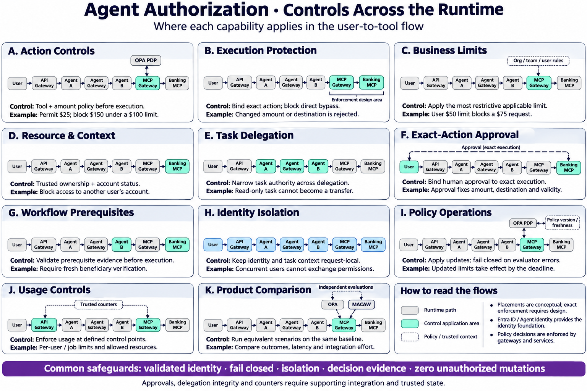

# Agent authorization — controls across the runtime

Created 2026-11-03 using built-in image generation. Conceptual application areas for the A–K capability catalog, not validated deployment placements. Every capability repeats the user-to-tool runtime. Highlighted components locate the relevant control area; exact enforcement, data sources and state require design. MACAW and OPA are independent comparison alternatives. The full runtime flow supersedes the earlier abstract mini-flow visual for this leadership presentation.

## Generation prompt

Use case: infographic-diagram. Leadership technical infographic, landscape wide canvas, white background, navy titles, large clear typography. Title “Agent Authorization · Controls Across the Runtime”. Subtitle “Where each capability applies in the user-to-tool flow”.
EXACTLY THREE EQUAL COLUMNS of cards in 4 rows. Row1 A B C; Row2 D E F; Row3 G H I; Row4 J K plus an unlabeled legend card. All letters A–K once. Equal visual weight. NO phase numbers, slice codes, initial/future/later priority or implementation status labels.

CRITICAL: EVERY ONE of the eleven lettered cards must repeat the SAME complete left-to-right runtime architecture, not an abstract workflow:
User → API Gateway → Agent A → Agent Gateway → Agent B → MCP Gateway → Banking MCP.
Use seven tiny clean labeled node boxes in a horizontal row inside each card, wrapping words within each box, NEVER wrapping the flow into another row. Use sufficient canvas width so full labels readable. Gateway labels must be explicit API Gateway, Agent Gateway, MCP Gateway. Keep overall diagram landscape high-resolution. Baseline boxes pale gray; color-highlight relevant control points per card. Each card contains title, repeated full runtime flow, short control annotation and simple example. Do NOT substitute “policy check→decision” flow for the full runtime chain.

A “Action Controls”: highlight MCP Gateway, draw small OPA PDP above with dotted bidirectional link to MCP Gateway. annotation “Tool + amount policy before execution”. Example “Permit $25; block $150 under a $100 limit.”
B “Execution Protection”: highlight MCP Gateway and Banking MCP with connecting segment. annotation “Bind exact action; block direct bypass”. Example “Changed amount or destination is rejected.” Small bracket MCP Gateway→Banking MCP denotes enforcement design area.
C “Business Limits”: highlight MCP Gateway; small dotted input label “Org / team / user rules”. annotation “Apply the most restrictive applicable limit”. Example “User $50 limit blocks a $75 request.”
D “Resource & Context”: highlight Banking MCP. annotation “Trusted ownership + account status”. Example “Block access to another user’s account.”
E “Task Delegation”: highlight Agent A, Agent Gateway, Agent B. annotation “Narrow task authority across delegation”. Example “Read-only task cannot become a transfer.” Do not add Agent C to full chain.
F “Exact-Action Approval”: highlight User and Banking MCP; dashed approval connector above full chain between them, no token arrow. annotation “Bind human approval to exact execution”. Example “Approval fixes amount, destination and validity.”
G “Workflow Prerequisites”: highlight Agent B and Banking MCP. annotation “Validate prerequisite evidence before execution”. Example “Require fresh beneficiary verification.”
H “Identity Isolation”: highlight whole chain light blue. annotation “Keep identity and task context request-local”. Example “Concurrent users cannot exchange permissions.”
I “Policy Operations”: highlight MCP Gateway; small OPA PDP with dotted link and tiny “Policy version / freshness”. annotation “Apply updates; fail closed on evaluator errors”. Example “Updated limits take effect by the deadline.”
J “Usage Controls”: highlight API Gateway and MCP Gateway; tiny “Trusted counters” above. annotation “Enforce usage at defined control points”. Example “Per-user / job limits and allowed resources.”
K “Product Comparison”: full runtime chain same, highlight MCP Gateway; above two SEPARATE little OPA and MACAW boxes connected with dotted alternative lines, label “Independent evaluations”, NOT in series. annotation “Run equivalent scenarios on the same baseline”. Example “Compare outcomes, latency and integration effort.”

12th card “How to read the flows”: small legend pale gray “Runtime path”; teal “Control application area”; dotted “Policy / trusted context”. Text “Placements are conceptual; exact enforcement requires design.” Text “Entra ID / Agent Identity provides the identity foundation.” Text “Policy decisions are enforced by gateways and services.”
Footer full-width purple “Common safeguards: validated identity · fail closed · isolation · decision evidence · zero unauthorized mutations”.
Small footer “Approvals, delegation integrity and counters require supporting integration and trusted state.”
Use repeated diagram carefully and enough space; shorten only example text if needed, never omit any of seven runtime nodes from any card. No fake green completion ticks or claim all placements implemented. Do not show every capability at every hop; highlight selected conceptual areas. OPA supplemental policy connectors only, never request path through OPA. Minimal icons, technical precision, no decorative clutter.

