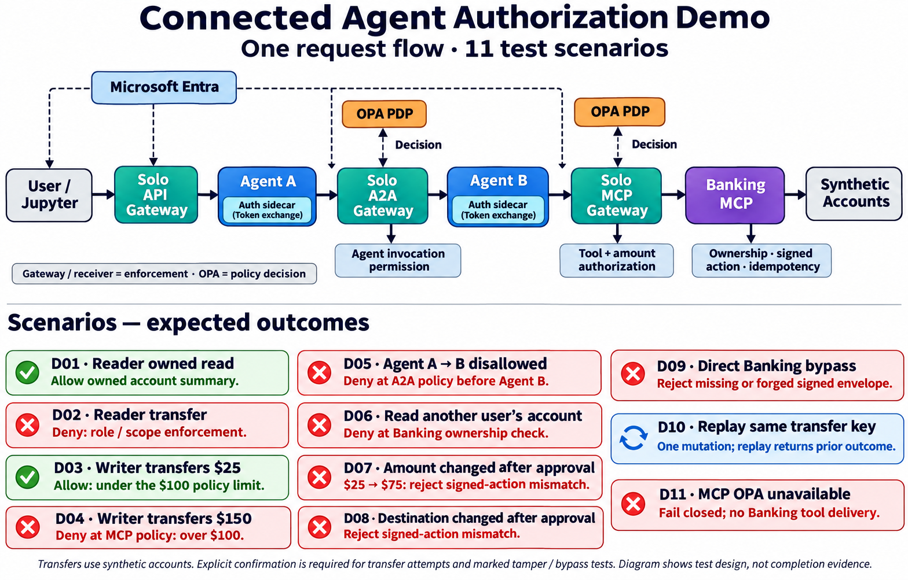

# Connected agent authorization demo — 11 scenarios

Created: 2026-11-04. Generated using the built-in image generation tool.

Status: test design, not completion evidence. Green/red icons represent expected allow/deny outcomes. Sidecars perform token acquisition/exchange; OPA makes decisions and gateways/receiver enforce them. D07/D08 change execution parameters after policy authorization; this is distinct from proving human approval binding.

## Generation prompt

Create a polished landscape technical infographic, white background, navy headings, large legible typography, approximately 16:10. Title: "Connected Agent Authorization Demo". Subtitle: "One request flow · 11 test scenarios". Show ONLY the connected flow and its scenario cards; no future roadmap, no unrelated components, no phase or slice numbers.

Top half: one prominent horizontal request path with 8 boxes and arrows:
"User / Jupyter" → "Solo API Gateway" → "Agent A" → "Solo A2A Gateway" → "Agent B" → "Solo MCP Gateway" → "Banking MCP" → "Synthetic Accounts".
Gateways distinct teal; agents blue; Banking purple. Small "Microsoft Entra" identity box above connects dashed to user and the authentication boundaries. Small "Auth sidecar" attached to Agent A and another attached to Agent B; label both "Token exchange". Show two separate orange OPA PDP boxes above their respective A2A and MCP gateways with bidirectional dashed "Decision" arrows. Labels beneath key enforcement points: A2A gateway "Agent invocation permission"; MCP gateway "Tool + amount authorization"; Banking MCP "Ownership · signed action · idempotency". Small legend "Gateway / receiver = enforcement · OPA = policy decision". Do not imply OPA forwards business traffic or issues Entra tokens.

Bottom half: 11 compact numbered cards in balanced 3-column grid, four cards first column, four second, three third. Every card has scenario number, clear concise text and an expected enforcement result. These are expected outcomes, NOT completed test results: no PASS badges. Section heading "Scenarios — expected outcomes".
Exact card content:
"D01 · Reader owned read" / "Allow owned account summary."
"D02 · Reader transfer" / "Deny: role / scope enforcement."
"D03 · Writer transfers $25" / "Allow: under the $100 policy limit."
"D04 · Writer transfers $150" / "Deny at MCP policy: over $100."
"D05 · Agent A → B disallowed" / "Deny at A2A policy before Agent B."
"D06 · Read another user's account" / "Deny at Banking ownership check."
"D07 · Amount changed after approval" / "$25 → $75: reject signed-action mismatch."
"D08 · Destination changed after approval" / "Reject signed-action mismatch."
"D09 · Direct Banking bypass" / "Reject missing or forged signed envelope."
"D10 · Replay same transfer key" / "One mutation; replay returns prior outcome."
"D11 · MCP OPA unavailable" / "Fail closed; no Banking tool delivery."
Use green accents for allowed outcomes, red for expected denials, blue for replay control, but not successful-test checkmarks. Small footer: "Transfers use synthetic accounts. Explicit confirmation is required for transfer attempts and marked tamper / bypass tests. Diagram shows test design, not completion evidence."
Ensure all 11 scenarios appear exactly once and all text is readable. No vendor logos necessary.

