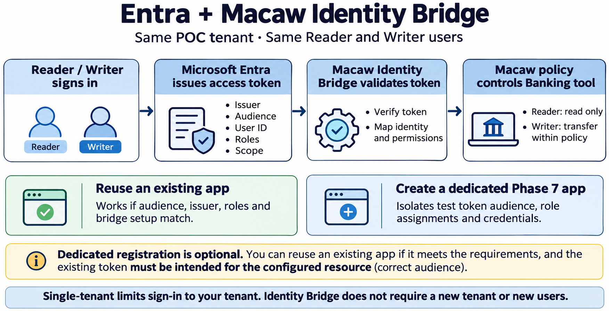

# Entra and Macaw Identity Bridge

Created 2026-11-06 with the built-in image generation tool. This is a proposed identity flow. App reuse and claim mapping remain to be verified in the POC workspace.

Sources: [Macaw Identity Bridge](https://www.macawsecurity.com/docs/concepts/identity-bridge), [Entra tenancy](https://learn.microsoft.com/en-us/entra/identity-platform/single-and-multi-tenant-apps), [Entra claims validation](https://learn.microsoft.com/en-us/entra/identity-platform/claims-validation).

## Generation prompt

Create a clear landscape technical infographic with white background and large readable text. Title “Entra + Macaw Identity Bridge”. Subtitle “Same POC tenant · Same Reader and Writer users”. Main left-to-right flow with four simple panels: “Reader / Writer signs in” → “Microsoft Entra issues access token” → “Macaw Identity Bridge validates token” → “Macaw policy controls Banking tool”. Under Entra token panel list “Issuer · Audience · User ID · Roles · Scope”. Under bridge list “Verify token · Map identity and permissions”. Under policy list “Reader: read only” and “Writer: transfer within policy”. Below show two equal option cards titled “Reuse an existing app” and “Create a dedicated Phase 7 app”. First card text “Works if audience, issuer, roles and bridge setup match.” Second card text “Isolates test token audience, role assignments and credentials.” Under both cards a footer “Single-tenant limits sign-in to your tenant. Identity Bridge does not require a new tenant or new users.” No logos, no secret values, no GUIDs. Emphasize dedicated registration is optional, existing token must be intended for the configured resource.
