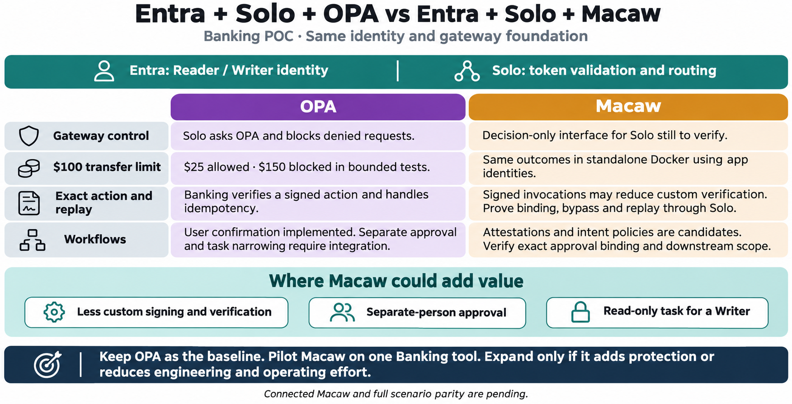

# Entra + Solo + OPA versus Entra + Solo + Macaw

Created 2026-11-06 with built-in image generation. The Macaw column combines standalone observations and proposed connected capabilities. Compare outcomes through the same Entra and Solo path before making a product decision.

References: [Solo external authorization](https://agentgateway.dev/docs/standalone/latest/documentation/configuration/security/external-authz/), [Macaw endpoint enforcement](https://www.macawsecurity.com/docs/concepts/peps), [Macaw attestations](https://www.macawsecurity.com/docs/attestations).

## Generation prompt

Create a polished wide landscape executive infographic. Title “Entra + Solo + OPA vs Entra + Solo + Macaw”. Subtitle “Banking POC · Same identity and gateway foundation”. Top teal shared band “Entra: Reader / Writer identity” and “Solo: token validation and routing”. Side-by-side columns, purple OPA and amber Macaw. Exactly four matched rows. Row 1 “Gateway control” OPA “Solo asks OPA and blocks denied requests.” Macaw “Decision-only interface for Solo still to verify.” Row 2 “$100 transfer limit” OPA “$25 allowed · $150 blocked in bounded tests.” Macaw “Same outcomes in standalone Docker using app identities.” Row 3 “Exact action and replay” OPA “Banking verifies a signed action and handles idempotency.” Macaw “Signed invocations may reduce custom verification. Prove binding, bypass and replay through Solo.” Row 4 “Workflows” OPA “User confirmation implemented. Separate approval and task narrowing require integration.” Macaw “Attestations and intent policies are candidates. Verify exact approval binding and downstream scope.” Below, a prominent “Where Macaw could add value” band with three visual chips: “Less custom signing and verification” / “Separate-person approval” / “Read-only task for a Writer”. Bottom executive recommendation: “Keep OPA as the baseline. Pilot Macaw on one Banking tool. Expand only if it adds protection or reduces engineering and operating effort.” Small note “Connected Macaw and full scenario parity are pending.” No vendor logos, clear readable layout, avoid claims of production validation or proof of exact action binding in Macaw.
