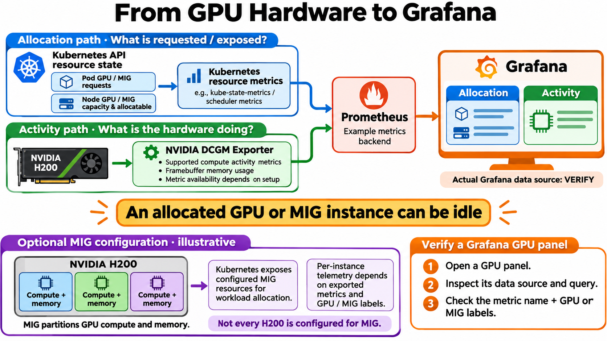

# From GPU Hardware to Grafana

Created and reviewed: 2026-11-03. Built-in image generation. Conceptual monitoring architecture, not a verified deployment. Prometheus is an example backend; inspect the actual Grafana data source and query. Kubernetes resource requests and node allocatable values describe resource state, not measured GPU activity or proof that a workload is running. Exported metrics and labels vary with hardware, driver, DCGM/exporter versions and configuration. Missing telemetry is not evidence of zero activity. Framebuffer memory usage is distinct from compute activity. The optional MIG drawing is schematic, not a supported profile layout or claim that MIG is enabled in the user's fleet.

## Primary references

- [NVIDIA DCGM Exporter metrics and labels](https://docs.nvidia.com/datacenter/dcgm/latest/reference/dcgm-exporter-metrics.html)
- [NVIDIA supported MIG profiles](https://docs.nvidia.com/datacenter/tesla/mig-user-guide/supported-mig-profiles.html)
- [Kubernetes object state metrics](https://kubernetes.io/docs/concepts/cluster-administration/kube-state-metrics/)

## Generation prompt

Use case: infographic-diagram. Create a landscape 16:9 technical infographic, pure white background, large labels, crisp enterprise technical illustration. Title exactly “From GPU Hardware to Grafana.”
Two clearly separate horizontal telemetry lanes converge into the SAME example Prometheus metrics backend, then Grafana on right. These arrows show metric/data flow, not inference or scheduling commands.
TOP blue lane title “Allocation path · What is requested / exposed?”
Source “Kubernetes API resource state” with two simple cards “Pod GPU / MIG requests” and “Node GPU / MIG capacity & allocatable”. Collector box “Kubernetes resource metrics” with small “e.g., kube-state-metrics / scheduler metrics”. Blue arrow to “Prometheus” backend labeled “Example metrics backend”. Do NOT call this metrics-server, do NOT imply requests prove actual utilization, do NOT assume request counts mean a pod is running.
BOTTOM green lane title “Activity path · What is the hardware doing?”
Source physical “NVIDIA H200” hardware icon → “NVIDIA DCGM Exporter” → same Prometheus. Under exporter compact text “Supported compute activity metrics” / “Framebuffer memory usage” / “Metric availability depends on setup”. GPU memory usage is NOT compute utilization. No guarantee GPU_UTIL works for all MIG instances. Generic labels, no unverified numerical metric values.
Prometheus → “Grafana” large monitor on right containing two distinct dashboard mini panels “Allocation” and “Activity”, not numerical fake production graphs. Visible label beneath “Actual Grafana data source: VERIFY”. Arrow shows backend supplies data / Grafana queries backend.
CENTER prominent amber callout exact “An allocated GPU or MIG instance can be idle”. Make this main explanatory takeaway, larger than small text.
LOWER LEFT inset: “Optional MIG configuration · illustrative”. Show ONE H200 package enclosing several clearly separated illustrative hardware partitions (three colored blocks allowed, no exact profile names, capacities, equal-slice math or implied production configuration). Each partition has “Compute + memory” label. Caption “MIG partitions GPU compute and memory.” Next short arrow to “Kubernetes exposes configured MIG resources for workload allocation.” Next note “Per-instance telemetry depends on exported metrics and GPU / MIG labels.” Add unmistakable “Not every H200 is configured for MIG.” Do not imply Kubernetes automatically creates MIG partitions or exporter performs allocation.
LOWER RIGHT short checklist headed “Verify a Grafana GPU panel” with EXACTLY three numbered steps:
“1. Open a GPU panel.”
“2. Inspect its data source and query.”
“3. Check the metric name + GPU or MIG labels.”
Use blue for allocation, green for activity, purple for optional MIG, orange for Grafana/callout. Clear legible text hierarchy, ample spacing, balanced composition. No vendor-specific deployment assumptions, no pretend confirmed data source, no fake production stats.

