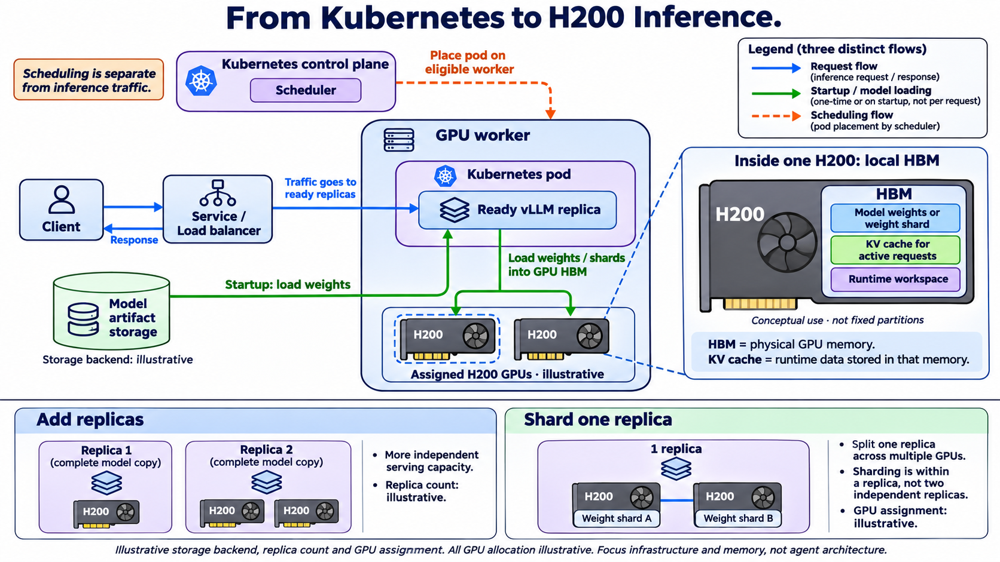

# From Kubernetes to H200 Inference

Created and reviewed: 2026-11-03. Generated with the built-in image generation tool. Illustrative architecture, not deployment evidence. Storage, replica count and GPU allocation are illustrative. Memory regions show conceptual uses, not fixed physical partitions. This simplified diagram omits CPU staging, caching/offload tiers, distributed multi-node replicas and detailed readiness checks. Replica scaling increases potential serving capacity; performance depends on workload, configuration and routing.

## Primary references

- [vLLM parallelism and scaling](https://docs.vllm.ai/en/latest/serving/parallelism_scaling/)
- [vLLM optimization and memory tuning](https://docs.vllm.ai/en/latest/configuration/optimization/)
- [Kubernetes GPU scheduling](https://kubernetes.io/docs/tasks/manage-gpus/scheduling-gpus/)

## Generation prompt

Use case: infographic-diagram. Landscape 16:9 enterprise technical infographic on white, crisp vector-style illustrations, large legible labels, navy typography. Title exactly “From Kubernetes to H200 Inference.”
Clearly separate THREE COLOR-CODED FLOWS with a legend:
BLUE solid “Request flow”
GREEN solid “Startup / model loading”
ORANGE dashed “Scheduling flow”.
Upper main architecture ~65%: left client and generic “Service / Load balancer”; right large “GPU worker” boundary holding a “Kubernetes pod” boundary with “Ready vLLM replica”. Blue arrows Client → Service / Load balancer → Ready vLLM replica; optional small blue return arrow “Response”. Label route “Traffic goes to ready replicas”. Request path never passes through control plane or artifact storage.
Below client (outside worker) generic storage cylinder “Model artifact storage” and “Storage backend: illustrative”. Green arrow storage → vLLM labeled “Startup: load weights”; green path vLLM → worker hardware assigned GPUs labeled “Load weights / shards into GPU HBM”. This green path is startup not per-request fetching. Inside worker beneath pod draw EXACTLY TWO H200 GPU packages labeled “Assigned H200 GPUs · illustrative”. Pod operates these GPU devices; hardware is physically in worker, not inside pod.
Control plane outside worker, distinctly separate, top-left/middle: “Kubernetes control plane” with “Scheduler”. Orange dashed arrow to WORKER boundary label “Place pod on eligible worker”. Add “Scheduling is separate from inference traffic”. Keep arrows noncrossing, use whitespace and colored lanes.
Right or lower-right attached zoom callout from ONE H200: “Inside one H200: local HBM”. Draw physical GPU package with a clearly bounded HBM memory block, with THREE conceptual sections labeled “Model weights or weight shard”, “KV cache for active requests”, “Runtime workspace”. Tiny label “Conceptual use · not fixed partitions”. Exact explanation under zoom: “HBM = physical GPU memory.” and “KV cache = runtime data stored in that memory.” Do not depict KV cache as external storage or a separate hardware chip. No implied unified memory across devices. No memory capacity figures.
Bottom ~30% side-by-side small comparison:
LEFT “Add replicas” shows two independent replica boxes, each with a complete model copy (each may use one or more GPUs); caption “More independent serving capacity” and “Replica count: illustrative”. Do not imply adding replicas splits weights or guarantees linear speedup.
RIGHT “Shard one replica” shows one enclosing “1 replica” boundary around two linked GPU boxes “Weight shard A” and “Weight shard B”; caption “Split one replica across multiple GPUs” / “GPU assignment: illustrative”. Highlight sharding is within a replica, not two independent replicas.
Footer small “Illustrative storage backend, replica count and GPU assignment.” All GPU allocation illustrative. Focus infrastructure and memory, not agent architecture. Clear geometric grouping, precise labels, ample whitespace, no vendor-specific storage backend, no extra products.

