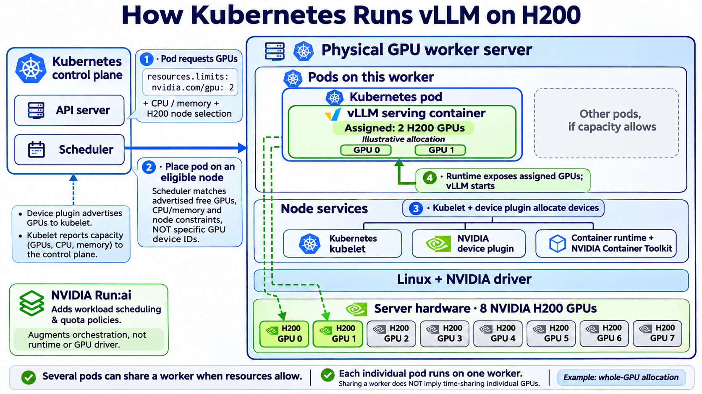

# How Kubernetes Runs vLLM on H200

Created and reviewed: 2026-11-03. Built-in image generation. Illustrative whole-GPU allocation, not deployment evidence. GPU resource requirements are declared per container within the pod; the compact resource label in the infographic is shorthand, not a complete YAML manifest. The device-plugin model is shown; alternative DRA configurations are outside this diagram.

## Sources

- [Kubernetes GPU scheduling](https://kubernetes.io/docs/tasks/manage-gpus/scheduling-gpus/)
- [Kubernetes device plugins](https://kubernetes.io/docs/concepts/extend-kubernetes/compute-storage-net/device-plugins/)

## Initial generation prompt

Use case: infographic-diagram. Create a crisp landscape 16:9 technical infographic, white background, large readable labels, navy headings, blue Kubernetes and green GPU accents. Title exactly “How Kubernetes Runs vLLM on H200.”
Focus infrastructure: zoom into ONE “Physical GPU worker server”. Within its outer boundary draw a clear BOTTOM-TO-TOP stack:
BOTTOM hardware band: “Server hardware · 8 NVIDIA H200 GPUs”. Draw EXACTLY eight H200 chip tiles in one row, numbered GPU 0 through GPU 7. Highlight ONLY GPU 0 and GPU 1 in bright green; remaining six neutral gray.
ABOVE hardware: “Linux + NVIDIA driver”.
ABOVE that: “Node services” with distinct side-by-side components “Kubernetes kubelet”, “NVIDIA device plugin”, “Container runtime + NVIDIA Container Toolkit”. Device plugin is a node-level service, NOT inside application pod and NOT part of control plane.
TOP application band: prominent “Kubernetes pod” boundary containing a single “vLLM serving container” box. Inside show “Assigned: 2 H200 GPUs” and exact label “Illustrative allocation”. Use thin matching green dashed connection lines from container to highlighted hardware GPU 0 and GPU 1 only, routed along edge so labels stay clear. A smaller faded neighboring pod box labeled “Other pods, if capacity allows” within same worker demonstrates colocation without implying shared access to same GPU. Don't draw more GPUs inside container; use two small identifiers GPU 0 / GPU 1 if needed.
OUTSIDE worker on left draw “Kubernetes control plane” boundary containing “API server” and “Scheduler”. Pod resource request small callout next to control plane: “1 · Pod requests GPUs” and compact monospace “resources.limits: nvidia.com/gpu: 2” and “+ CPU / memory + H200 node selection”. This represents 2 whole GPUs; no fractional sharing.
Draw prominent arrow from Scheduler to worker labeled “2 · Place pod on an eligible node”. Explain scheduler matches advertised free GPUs, CPU/memory and node constraints, NOT specific GPU device IDs.
Near node services show step “3 · Kubelet + device plugin allocate devices” then arrow to container labeled “4 · Runtime exposes assigned GPUs; vLLM starts”. Device plugin advertises GPUs to kubelet; kubelet reports capacity to control plane (small dashed feedback arrow if space).
Small external Run:ai callout: “NVIDIA Run:ai” / “Adds workload scheduling & quota policies”. It augments orchestration, not runtime or GPU driver. Do not specify a replacement.
Footer exact concise statements “Several pods can share a worker when resources allow.” and “Each individual pod runs on one worker.” Sharing a worker does NOT imply time-sharing individual GPUs. Include small note “Example: whole-GPU allocation”. No inference request flow, no models, no APIs for users, no extra physical servers. Beautiful organized enterprise infographic with readable hierarchy and noncrossing arrows.

## Boundary correction prompt

Edit this infographic with one targeted structural correction: In the top application layer of the physical worker, the large outer box currently titled 'Kubernetes pod' incorrectly contains both the vLLM container and 'Other pods'. Change that large outer layer title to 'Pods on this worker'. Add a distinct blue pod boundary around ONLY the existing green vLLM serving container and label that individual boundary 'Kubernetes pod'. Keep the neighboring dashed 'Other pods, if capacity allows' box OUTSIDE the individual Kubernetes pod boundary, but inside the outer 'Pods on this worker' layer. Preserve all other text, exactly eight hardware GPUs, two highlighted GPUs, control plane, stack, colors and layout. Keep all labels readable.

