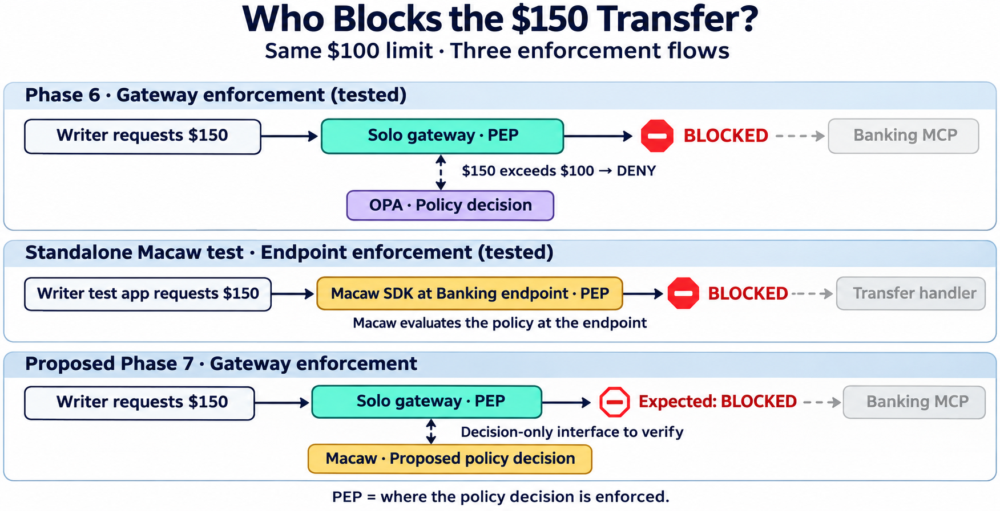

# Who blocks the $150 transfer?

Created 2026-11-06 with the built-in image generation tool.

Phase 6 gateway enforcement and standalone Macaw SDK endpoint enforcement were tested separately. The proposed Phase 7 gateway flow depends on verification of a supported Macaw decision-only interface for Solo. The standalone test used Macaw app identities.

## Generation prompt

Create a clean landscape technical infographic titled “Who Blocks the $150 Transfer?” Subtitle “Same $100 limit · Three enforcement flows”. White background, navy text, teal Solo, violet OPA, amber Macaw. Three horizontal lanes with large text and arrows. Lane 1 title “Phase 6 · Gateway enforcement (tested)”. Main path “Writer requests $150” → “Solo gateway · PEP” → red stop symbol “BLOCKED” before a faded “Banking MCP”. Draw a separate dashed two-way decision link between Solo and “OPA · Policy decision”, label “$150 exceeds $100 → DENY”. Lane 2 title “Standalone Macaw test · Endpoint enforcement (tested)”. Main path “Writer test app requests $150” → “Macaw SDK at Banking endpoint · PEP” → red stop symbol “BLOCKED” before faded “Transfer handler”. No Solo in this lane. Label “Macaw evaluates the policy at the endpoint”. Lane 3 title “Proposed Phase 7 · Gateway enforcement”. Main path “Writer requests $150” → “Solo gateway · PEP” → red outlined stop “Expected: BLOCKED” before faded “Banking MCP”. Separate dashed two-way decision link between Solo and “Macaw · Proposed policy decision”, label “Decision-only interface to verify”. Never draw Macaw in the forwarding path for lane 3. Footer “PEP = where the policy decision is enforced.” Clean and legible, exact labels, no extra boxes or checkmarks implying Phase 7 passed.
