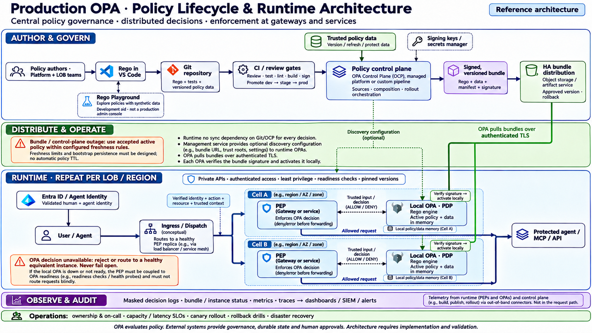

# Production OPA: policy lifecycle and runtime

Reviewed 2026-11-04. Generated using built-in image generation. Reference architecture; not deployed POC evidence. Select and pin the actual control-plane/distribution components before production adoption.

## Design qualifications

- Playground is an authoring/learning tool; use synthetic inputs. It is not a production administration console.
- A control plane or CI pipeline composes and publishes bundles. OCP publishes bundles to external storage; OPA downloads them from there. Signing, approval, promotion and optional discovery must be implemented/configured in the chosen management system; not every function is a native OCP feature.
- Configure bundle signature enforcement explicitly and provision trust keys securely. Retaining a trusted active bundle on download failure is separate from decision-service availability.
- OPA evaluates local policy/data. Bundle freshness cutoffs, bootstrap/persistence, policy revocation deadlines, readiness coupling and failure routing require explicit designs; OPA does not automatically expire policy by a universal TTL.
- PEPs forward allowed requests; OPA returns decisions only. Alternative instances must carry acceptable equivalent policy/data/context. Readiness and routing must be tested.
- Mask decision inputs, protect management APIs and isolate LOB data. Durable approval/counter state and atomic business execution remain supporting application responsibilities.

## Primary sources

- [Bundles and signing](https://www.openpolicyagent.org/docs/management-bundles)
- [OCP concepts and external distribution](https://www.openpolicyagent.org/docs/ocp/concepts)
- [Discovery](https://www.openpolicyagent.org/docs/management-discovery)
- [Decision logging](https://www.openpolicyagent.org/docs/management-decision-logs)
- [Rego Playground](https://play.openpolicyagent.org/)

## Generation prompt

Use case: infographic-diagram. Create a complete leadership and technical production reference architecture infographic landscape 16:9, white background, large crisp readable labels, navy headings, blue/teal runtime, green delivery, purple observability, orange failure controls. Title “Production OPA · Policy Lifecycle & Runtime Architecture”. Subtitle “Central policy governance · distributed decisions · enforcement at gateways and services”. Small label “Reference architecture”.
LAYOUT: clear three horizontal layers with noncrossing arrows and precise separation.

TOP layer “AUTHOR & GOVERN”:
left “Policy authors · Platform + LOB teams” → “Rego in VS Code” → “Git repository” → “CI / review gates”.
Below/alongside editor a smaller dotted box “Rego Playground” with “Explore policies with synthetic data” and “Development aid · not a production admin console”. Playground connects only to authoring, NOT production runtime.
Git label “Rego + tests + versioned policy data”.
CI box “Review · test · lint · build · sign” and “Promote dev → stage → prod”.
Management box “Policy control plane” with “OPA Control Plane (OCP), managed platform or custom pipeline” and “Sources · composition · rollout orchestration”. This is an external component, not inside OPA engine. Connect Git/CI to management, and management to release artifact.
“Signing keys / secrets manager” tiny box supports signing, dotted.
Artifact package “Signed, versioned bundle” with interior small “Rego + data + manifest + signature”.
Arrow artifact → “HA bundle distribution” with “Object storage / artifact service” and “Approved version · rollback”.
IMPORTANT OCP orchestrates build and publishes bundle to object storage, OCP is NOT shown as a runtime decision server or inherently the bundle server.
Trusted business data source box “Trusted policy data” feeds management/build; label “Version / refresh / protect data”. Dynamic per-request resource facts can feed PEP separate below.

MIDDLE layer “DISTRIBUTE & OPERATE” thin band:
From HA distribution show DOWNWARD GREEN delivery arrows “OPA pulls bundles over authenticated TLS” to runtime OPA instances below. Tiny “Verify signature → activate locally” beside each OPA.
Management optional dotted line “Discovery configuration” to runtime OPAs.
Callout “Bundle / control-plane outage: use accepted active policy within configured freshness rules.” Follow “Freshness limits and bootstrap persistence must be designed; no automatic policy TTL.” Runtime no sync dependency on Git/OCP for every decision.

BOTTOM large layer “RUNTIME · REPEAT PER LOB / REGION”:
Left Entra box “Entra ID / Agent Identity” “Validated human + agent identity” to gateway identity foundation.
Draw clear main request path “User / Agent” → “Gateway or service · PEP” → “Protected agent / MCP / API”. PEP blocks DENY/error before forwarding. OPA NEVER sits in forwarding path.
Within runtime show TWO availability cells side by side or stacked, clearly “Cell A” and “Cell B”. Each contains “PEP” + “Local OPA · PDP” with bidirectional dotted link “Trusted input / decision”. A conceptual ingress dispatches to healthy PEP replicas; PEP forwards to protected service. Can simplify main path and separate HA inset with two PEP+OPA pairs. Cell replicas have separate local policy/data memory.
Inside OPA box “Rego engine” and “Active policy + data in memory”. OPA supplies ALLOW/DENY to PEP.
Small context label to PEP “Verified identity + action + resource + trusted context”.
Security note “Private APIs · authenticated access · least privilege · readiness checks · pinned versions”.
Orange callout “OPA decision unavailable: reject or route to a healthy equivalent instance. Never fail open.” Explain local OPA down PEP readiness coupling required, do not route blindly.
Full-width horizontal purple bar below “OBSERVE & AUDIT” with “Masked decision logs · bundle / instance status · metrics · traces → dashboards / SIEM / alerts”. Thin telemetry connectors from runtime and control plane; not inline request path.
Small bottom strip “Operations: ownership & on-call · capacity / latency SLOs · canary rollout · rollback drills · disaster recovery”.
Footer “OPA evaluates policy. External systems provide governance, durable state and human approvals. Architecture requires implementation and validation.”
Readable polished clear structure, practical production topics, no claim that all options deployed, no public prod Playground with real secrets, no full proprietary adminUI implied, no arrows from OPA directly to backend, no single central mandatory PDP.

## Request-path correction

Correct ONLY request-path wiring in the RUNTIME section. Currently the solid navy forwarding lines originate at the Local OPA PDP boxes and go to Protected agent/MCP/API; this is WRONG. Remove every solid forwarding connection from BOTH Local OPA boxes to the protected backend. Instead draw solid navy forwarding lines that originate at the RIGHT EDGE of each PEP Gateway/service box, route along the BOTTOM edge of its cell BELOW the OPA box (with adequate clearance from labels), then exit the cell on the right and join into the Protected agent/MCP/API. Label these lines 'Allowed request' if space. OPA must have ONLY the dotted bidirectional query/decision connection to its PEP and green bundle/discovery connections; NO direct request-forwarding arrow from OPA to protected service. Preserve everything else including all authoring, bundle, Playground, availability, observability and explanatory text. Also replace the middle-band bullet 'OCP provides optional discovery configuration' with 'Management service provides optional discovery configuration' to avoid implying OCP natively implements discovery. Keep landscape white architecture unchanged otherwise.

