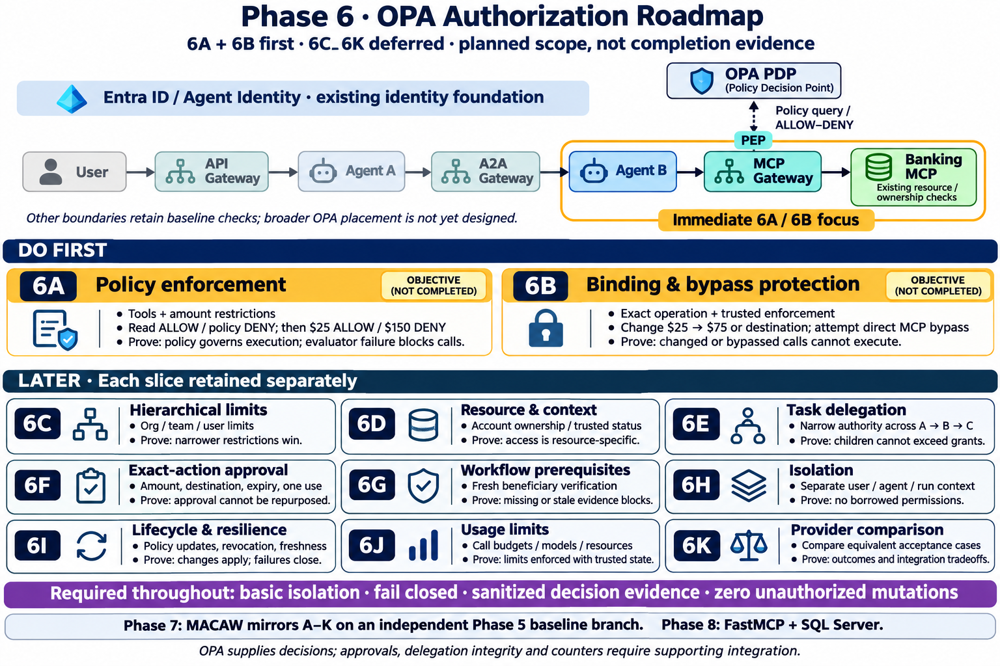

# Phase 6 OPA roadmap — all slices

Created: 2026-11-03 using built-in image generation. Planned scope, not implementation/completion evidence. Source: POC docs/phase-6-slices-and-priorities.md and docs/phase-7-macaw-plan.md.

Immediate scope: 6A/6B at the Agent B → MCP gateway → Banking MCP boundary. The MCP gateway is the proposed 6A PEP; 6B binding/bypass protection needs its own design and may require receiver enforcement. Later slice cards describe objectives, not fixed deployment placements or native OPA features. Baseline ownership checks remain mandatory even though 6D expands resource/context policies. MACAW is Phase 7 with matching 7A–7K; FastMCP and SQL Server are Phase 8. This supersedes the phase numbering in earlier infographics without deleting those historical assets.

## Generation prompt

Use case: infographic-diagram. Create a polished landscape technical infographic, white background, exceptionally readable large labels, navy headings, consistent flat enterprise icons. Title “Phase 6 · OPA Authorization Roadmap”. Subtitle “6A + 6B first · 6C–6K deferred · planned scope, not completion evidence”.
TOP ~30% show whole existing runtime horizontal chain:
User → API Gateway → Agent A → A2A Gateway → Agent B → MCP Gateway → Banking MCP.
Gateways teal, agents blue, Banking MCP green. Keep User/API/A/A2A desaturated baseline. Above label “Entra ID / Agent Identity · existing identity foundation”.
Highlight ONLY Agent B → MCP Gateway → Banking MCP with bright amber bracket label “Immediate 6A / 6B focus”. Draw OPA PDP box above MCP Gateway and a thin bidirectional dotted “Policy query / ALLOW–DENY” link to MCP Gateway labeled “PEP”. OPA not in inline request chain. Banking MCP has small “Existing resource / ownership checks”. 6A gateway policy, 6B exact binding / bypass design, not necessarily a hook inside Agent B. Small note “Other boundaries retain baseline checks; broader OPA placement is not yet designed.”
MIDDLE two large emphasized side-by-side cards with dark blue and amber accents under header “DO FIRST”:
“6A · Policy enforcement”
“Tools + amount restrictions”
“Read ALLOW / policy DENY; then $25 ALLOW / $150 DENY”
“Prove: policy governs execution; evaluator failure blocks calls.”
“6B · Binding & bypass protection”
“Exact operation + trusted enforcement”
“Change $25 → $75 or destination; attempt direct MCP bypass”
“Prove: changed or bypassed calls cannot execute.”
Clearly mark these are objectives, not already completed controls.
LOWER section header “LATER · Each slice retained separately”. Arrange NINE equally readable compact cards in 3 columns by 3 rows, each has badge distinct visible slice code, exact title and short proof:
“6C · Hierarchical limits”
“Org / team / user limits”
“Prove: narrower restrictions win.”
“6D · Resource & context”
“Account ownership / trusted status”
“Prove: access is resource-specific.”
“6E · Task delegation”
“Narrow authority across A → B → C”
“Prove: children cannot exceed grants.”
“6F · Exact-action approval”
“Amount, destination, expiry, one use”
“Prove: approval cannot be repurposed.”
“6G · Workflow prerequisites”
“Fresh beneficiary verification”
“Prove: missing or stale evidence blocks.”
“6H · Isolation”
“Separate user / agent / run context”
“Prove: no borrowed permissions.”
“6I · Lifecycle & resilience”
“Policy updates, revocation, freshness”
“Prove: changes apply; failures close.”
“6J · Usage limits”
“Call budgets / models / resources”
“Prove: limits enforced with trusted state.”
“6K · Provider comparison”
“Compare equivalent acceptance cases”
“Prove: outcomes and integration tradeoffs.”
All nine marked LATER collectively, no green completion ticks.
Bottom horizontal purple band “Required throughout: basic isolation · fail closed · sanitized decision evidence · zero unauthorized mutations”.
Footer concise “Phase 7: MACAW mirrors A–K on an independent Phase 5 baseline branch. Phase 8: FastMCP + SQL Server.”
Tiny qualification “OPA supplies decisions; approvals, delegation integrity and counters require supporting integration.”
Do not hide or merge slice codes. Exactly 11 slice cards 6A through 6K, each once. Basic ownership protections remain today despite later6D. Current live Agent Identity OPA integration is not claimed complete. No NeMo, GPU hardware, extra agents in main chain, new cloud services or mandatory policy-at-every-hop assumption. Design for readable zoomable landscape infographic, minimal decorative clutter.

