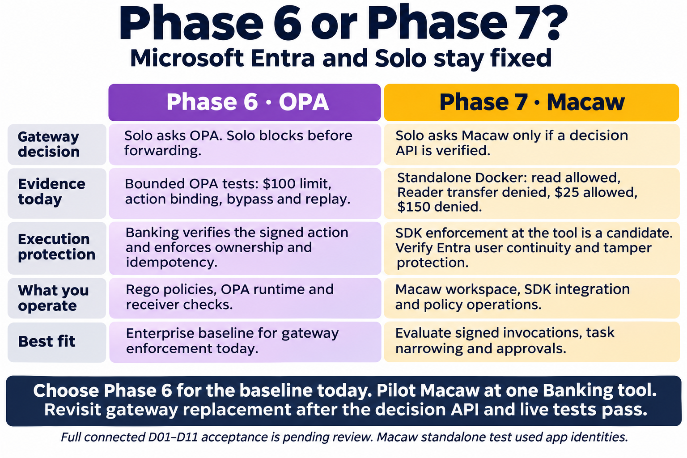

# Phase 6 OPA versus Phase 7 Macaw

Created 2026-11-06 with built-in image generation. Recommendation based on bounded local POC evidence. Production readiness requires separate validation. The Macaw Docker check used application identities. See [Macaw endpoint enforcement](https://www.macawsecurity.com/docs/concepts/peps) and [Solo external authorization](https://agentgateway.dev/docs/standalone/latest/documentation/configuration/security/external-authz/).

## Generation prompt

Create a landscape two-column leadership infographic, white background, navy text, large typography. Title “Phase 6 or Phase 7?” Subtitle “Microsoft Entra and Solo stay fixed”. Left purple column “Phase 6 · OPA” right amber column “Phase 7 · Macaw”. Five matched comparison rows with concise exact labels and text. Row 1 “Gateway decision” left “Solo asks OPA. Solo blocks before forwarding.” right “Solo asks Macaw only if a decision API is verified.” Row 2 “Evidence today” left “Bounded OPA tests: $100 limit, action binding, bypass and replay.” right “Standalone Docker: read allowed, Reader transfer denied, $25 allowed, $150 denied.” Row 3 “Execution protection” left “Banking verifies the signed action and enforces ownership and idempotency.” right “SDK enforcement at the tool is a candidate. Verify Entra user continuity and tamper protection.” Row 4 “What you operate” left “Rego policies, OPA runtime and receiver checks.” right “Macaw workspace, SDK integration and policy operations.” Row 5 “Best fit” left “Enterprise baseline for gateway enforcement today.” right “Evaluate signed invocations, task narrowing and approvals.” Footer prominent “Choose Phase 6 for the baseline today. Pilot Macaw at one Banking tool. Revisit gateway replacement after the decision API and live tests pass.” Add a small note “Full connected D01–D11 acceptance is pending review. Macaw standalone test used app identities.” No product logos, no checkmarks implying all scenarios passed, clean 2-column contrast.
