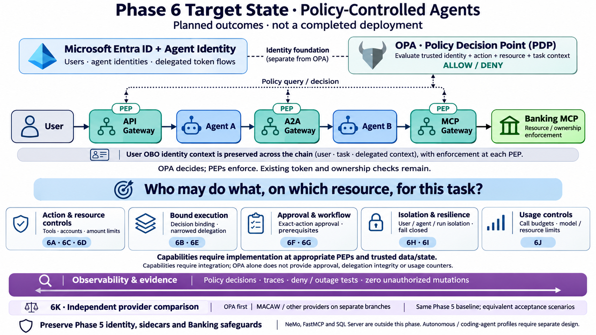

# Phase 6 target state: policy-controlled agents

Created: 2026-11-03. Built-in image generation from the repository's Phase 6 roadmap. Planned outcomes, not completed deployment evidence.

The current first gate is 6A-OPA-Read at the MCP gateway. The additional gateway policy queries and capability cards depict later integration candidates, not verified placements or automatic OPA features. Phase 5 identity, token exchanges, sidecars and receiver safeguards remain. Exact-action approval, delegation integrity and budgets need supporting trusted state and enforcement. Autonomous and coding-agent profiles require separate design. MACAW and future providers are independent comparison branches, not mandatory components alongside OPA.

Source of scope: enterprise-agent-poc-starter/docs/solo-full-poc-plan.md (Phase 6 slices 6A–6K), and docs/phase-6-opa-first-plan.md; inspected 2026-11-03.

## Generation prompt

Use case: infographic-diagram. Create a landscape 16:9 enterprise technical infographic white background, large clear navy labels, attractive clean flat icons and generous whitespace.
Title “Phase 6 Target State · Policy-Controlled Agents”.
Subtitle “Planned outcomes · not a completed deployment”.
Center horizontal banking runtime chain using concise distinct boxes:
“User” → “API Gateway” → “Agent A” → “A2A Gateway” → “Agent B” → “MCP Gateway” → “Banking MCP”.
Gateways teal, agents blue, Banking MCP green. Label gateway enforcement points “PEP”. Label Banking MCP “Resource / ownership enforcement”. Keep all arrows flow left-to-right, NEVER through OPA. User OBO identity context is preserved across the chain; don't depict one bearer token reused all hops.
Above chain LEFT box “Microsoft Entra ID + Agent Identity” with small “Users · agent identities · delegated token flows”. Dashed lines indicate identity foundation separate from OPA.
Above chain RIGHT box “OPA · Policy Decision Point (PDP)” with “Evaluate trusted identity + action + resource + task context” and “ALLOW / DENY”. Use thin bidirectional dotted connectors between OPA and gateway/resource PEPs, labeled “Policy query / decision”. Caption “OPA decides; PEPs enforce. Existing token and ownership checks remain.”
Below chain FIVE capability cards, clearly planned outcomes:
“Action & resource controls” / “Tools · accounts · amount limits” / “6A · 6C · 6D”
“Bound execution” / “Decision binding · narrowed delegation” / “6B · 6E”
“Approval & workflow” / “Exact-action approval · prerequisites” / “6F · 6G”
“Isolation & resilience” / “User / agent / run isolation · fail closed” / “6H · 6I”
“Usage controls” / “Call budgets · model / resource limits” / “6J”
All capabilities require implementation at appropriate PEPs and trusted data/state; small note “Capabilities require integration; OPA alone does not provide approval, delegation integrity or usage counters.”
Bottom full-width purple horizontal “Observability & evidence” bar, with “Policy decisions · traces · deny / outage tests · zero unauthorized mutations” connected to runtime across whole flow (observability horizontal).
Small side/bottom strip “6K · Independent provider comparison” / “OPA first | MACAW / other providers on separate branches” / “Same Phase 5 baseline; equivalent acceptance scenarios”. Do not show MACAW in series with OPA, not a required simultaneous component.
Footer “Preserve Phase 5 identity, sidecars and Banking safeguards” and a small scope note “NeMo, FastMCP and SQL Server are outside this phase. Autonomous / coding-agent profiles require separate design.”
Make central takeaway prominent “Who may do what, on which resource, for this task?”
Do not portray roadmap controls as all built-in OPA features. No production HA cluster/bundle pipeline implied. No extra agents, no GPU hardware. This illustrates END-OF-PHASE-6 planned scope, not current implementation.

