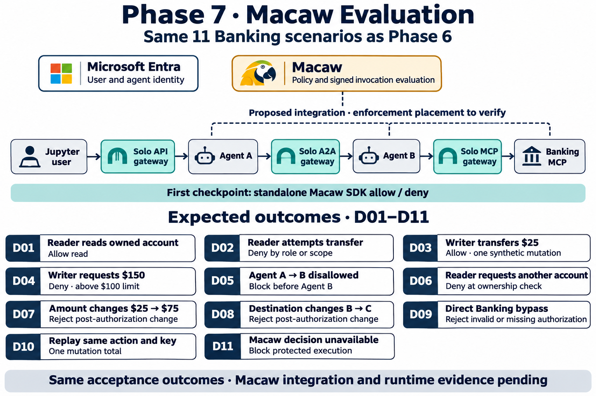

# Phase 7 Macaw Banking scope

Created 2026-11-06 with the built-in image generation tool.

The diagram shows the proposed connected evaluation with the Phase 6 acceptance scenarios. Macaw placement and runtime behavior require verification. The standalone SDK smoke test is a separate first checkpoint.

## Generation prompt

Landscape leadership infographic, clean white background, navy typography, teal gateways, amber Macaw. Title “Phase 7 · Macaw Evaluation” subtitle “Same 11 Banking scenarios as Phase 6”. Top one horizontal path with readable compact boxes: “Jupyter user” → “Solo API gateway” → “Agent A” → “Solo A2A gateway” → “Agent B” → “Solo MCP gateway” → “Banking MCP”. Above: “Microsoft Entra” labeled “User and agent identity”; “Macaw” labeled “Policy and signed invocation evaluation”; connect Macaw via dashed lines to a bracket over agents and Banking, labeled “Proposed integration · enforcement placement to verify”. No OPA box, no suggestion that Macaw plugs into Solo directly or replaces Entra. Under diagram a small strip “First checkpoint: standalone Macaw SDK allow / deny”. Lower section “Expected outcomes · D01–D11”, exactly 11 numbered cards, 3 columns, short text:
D01 “Reader reads owned account” / “Allow read”
D02 “Reader attempts transfer” / “Deny by role or scope”
D03 “Writer transfers $25” / “Allow · one synthetic mutation”
D04 “Writer requests $150” / “Deny · above $100 limit”
D05 “Agent A → B disallowed” / “Block before Agent B”
D06 “Reader requests another account” / “Deny at ownership check”
D07 “Amount changes $25 → $75” / “Reject post-authorization change”
D08 “Destination changes B → C” / “Reject post-authorization change”
D09 “Direct Banking bypass” / “Reject invalid or missing authorization”
D10 “Replay same action and key” / “One mutation total”
D11 “Macaw decision unavailable” / “Block protected execution”
Footer “Same acceptance outcomes · Macaw integration and runtime evidence pending”. No checkmarks implying completion. Large text, sufficient spacing, exactly one instance per scenario.
