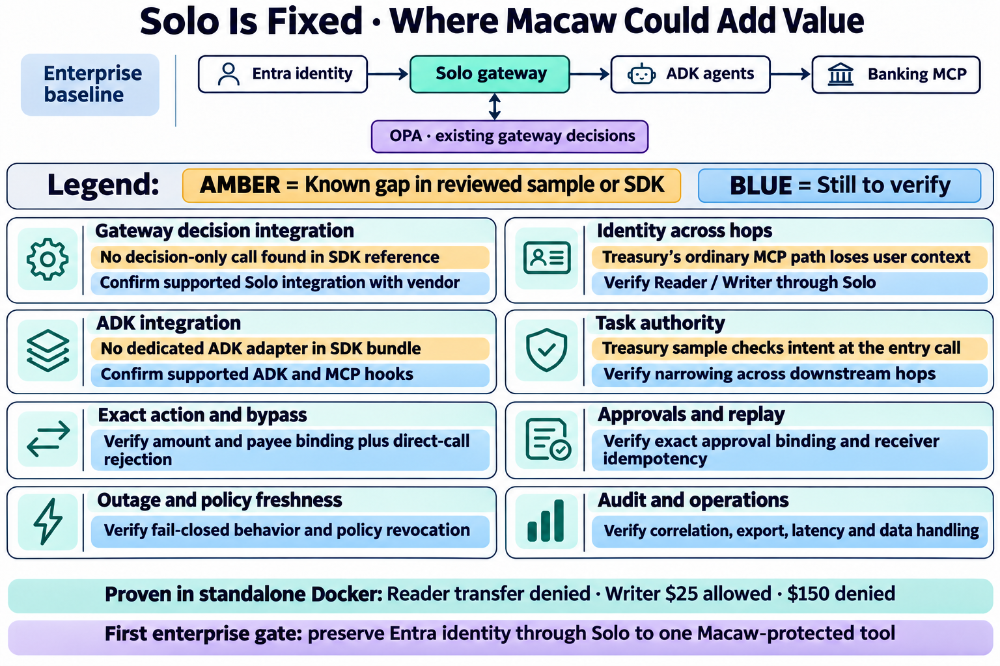

# Solo and Macaw enterprise gaps — status colors

Created 2026-11-06 using built-in image generation. Amber marks findings limited to the reviewed sample, bundle or SDK documentation. Blue marks an open verification item. See the [original diagram and sources](solo-macaw-enterprise-gaps.md).

## Generation prompt

Edit the attached infographic. Preserve the title, enterprise baseline diagram, 8 card grid and the two bottom strips. Add a prominent legend above cards: AMBER “Known gap in reviewed sample or SDK” and BLUE “Still to verify”. Replace the previous uniformly amber candidate lines with color-coded status lines. Put amber background on known-gap lines and pale blue background on verification lines. Use exactly these 8 card headings and lines, each appears once:
Gateway decision integration — AMBER “No decision-only call found in SDK reference” — BLUE “Confirm supported Solo integration with vendor”
Identity across hops — AMBER “Treasury’s ordinary MCP path loses user context” — BLUE “Verify Reader / Writer through Solo”
ADK integration — AMBER “No dedicated ADK adapter in SDK bundle” — BLUE “Confirm supported ADK and MCP hooks”
Task authority — AMBER “Treasury sample checks intent at the entry call” — BLUE “Verify narrowing across downstream hops”
Exact action and bypass — BLUE “Verify amount and payee binding plus direct-call rejection”
Approvals and replay — BLUE “Verify exact approval binding and receiver idempotency”
Outage and policy freshness — BLUE “Verify fail-closed behavior and policy revocation”
Audit and operations — BLUE “Verify correlation, export, latency and data handling”
Keep typography large and high contrast. The two colors must be obvious. Do not label unknown vendor capabilities as product limitations. Preserve proven standalone evidence in the footer.
