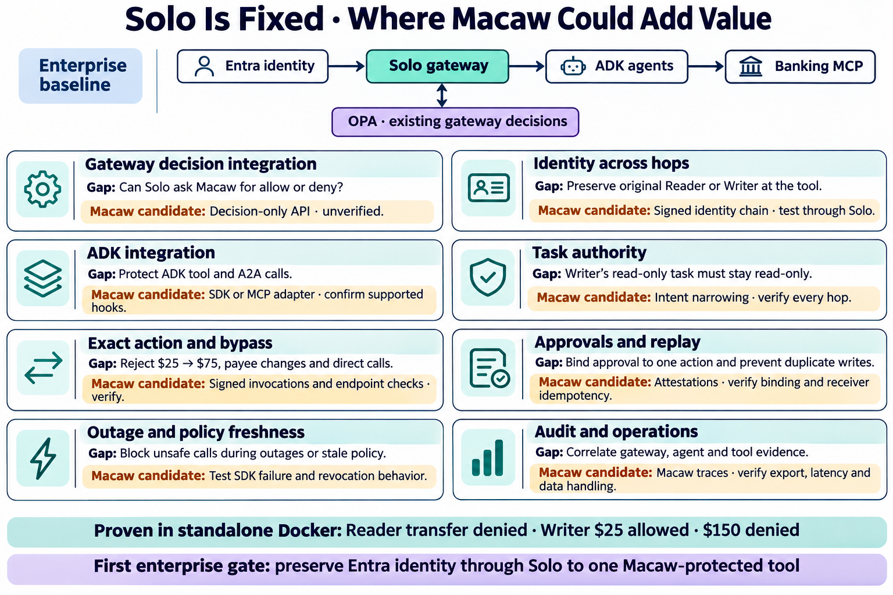

# Solo is fixed — where Macaw could add value

Created 2026-11-06 with built-in image generation.

These are evaluation questions. Phase 6 has bounded evidence for binding, bypass and replay. The standalone Macaw test used application identities. See [Solo external authorization](https://agentgateway.dev/docs/standalone/latest/documentation/configuration/security/external-authz/) and [Macaw endpoint enforcement](https://www.macawsecurity.com/docs/concepts/peps).

## Generation prompt

Make a polished landscape enterprise infographic titled "Solo Is Fixed · Where Macaw Could Add Value". White background, navy text, teal Solo, purple OPA, amber Macaw. Top small flow "Entra identity → Solo gateway → ADK agents → Banking MCP" with a separate "OPA · existing gateway decisions" below Solo. Label "Enterprise baseline". Below use a readable 2-column by 4-row grid of 8 cards. Each card has heading, "Gap" line and "Macaw candidate" line. Use exactly these concise texts:
1. "Gateway decision integration" / "Gap: Can Solo ask Macaw for allow or deny?" / "Candidate: Decision-only API · unverified".
2. "Identity across hops" / "Gap: Preserve original Reader or Writer at the tool" / "Candidate: Signed identity chain · test through Solo".
3. "ADK integration" / "Gap: Protect ADK tool and A2A calls" / "Candidate: SDK or MCP adapter · confirm supported hooks".
4. "Task authority" / "Gap: Writer's read-only task must stay read-only" / "Candidate: Intent narrowing · verify every hop".
5. "Exact action and bypass" / "Gap: Reject $25 → $75, payee changes and direct calls" / "Candidate: Signed invocations and endpoint checks · verify".
6. "Approvals and replay" / "Gap: Bind approval to one action and prevent duplicate writes" / "Candidate: Attestations · verify binding and receiver idempotency".
7. "Outage and policy freshness" / "Gap: Block unsafe calls during outages or stale policy" / "Candidate: Test SDK failure and revocation behavior".
8. "Audit and operations" / "Gap: Correlate gateway, agent and tool evidence" / "Candidate: Macaw traces · verify export, latency and data handling".
Bottom two strips "Proven in standalone Docker: Reader transfer denied · Writer $25 allowed · $150 denied" and "First enterprise gate: preserve Entra identity through Solo to one Macaw-protected tool". Important: label candidates clearly, no claims of verified integration, no logos, all eight cards exactly once, readable typography.
