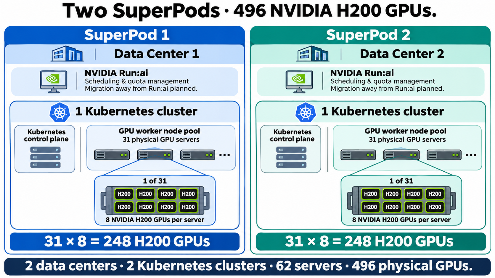

# Two SuperPods · 496 NVIDIA H200 GPUs

Created: 2026-11-03. Generated using the built-in image generation tool from user-supplied architecture requirements; not deployment evidence.

## Generation prompt

Use case: infographic-diagram. Create a polished landscape technical infographic on a pure white background with large legible labels and clean flat technical illustrations. Title exactly: “Two SuperPods · 496 NVIDIA H200 GPUs.”
Two equal side-by-side panels, left blue accent, right teal accent.
LEFT headers “SuperPod 1” and “Data Center 1”. RIGHT headers “SuperPod 2” and “Data Center 2”.
Each data center encloses exactly ONE Kubernetes cluster, clearly bounded and labeled “1 Kubernetes cluster”. Inside each cluster show a “Kubernetes control plane” box and a separate “GPU worker node pool” labeled “31 physical GPU servers”. Represent pool schematically without suggesting an exact count through a handful of unlabeled icons; the explicit 31 label establishes total. Control plane is not counted as an additional GPU server.
For EACH site show prominent arithmetic exactly “31 × 8 = 248 H200 GPUs”.
Within EACH cluster include a magnified representative physical GPU server inset, connected to worker pool by zoom lines. Label server exactly “1 of 31”. Inside this inset draw EXACTLY EIGHT GPU chip tiles arranged in TWO ROWS OF FOUR. Each chip says “H200”. Label inset “8 NVIDIA H200 GPUs per server”. These are zoom details of existing servers, not extra servers.
In each panel include a compact scheduling-management callout “NVIDIA Run:ai” with “Scheduling & quota management” and “Migration away from Run:ai planned.” Do NOT specify, name, or depict any replacement product.
Full-width footer exactly: “2 data centers · 2 Kubernetes clusters · 62 servers · 496 physical GPUs.”
Keep count arithmetic visually prominent, balanced equal panels, generous whitespace, crisp professional enterprise technical infographic. No extra clusters, no shared cluster across sites, no extra GPU totals, no inter-site topology assumptions. Landscape 16:9 composition.
